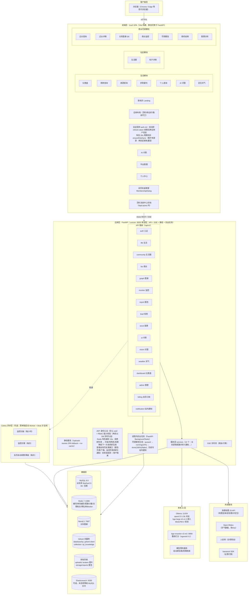
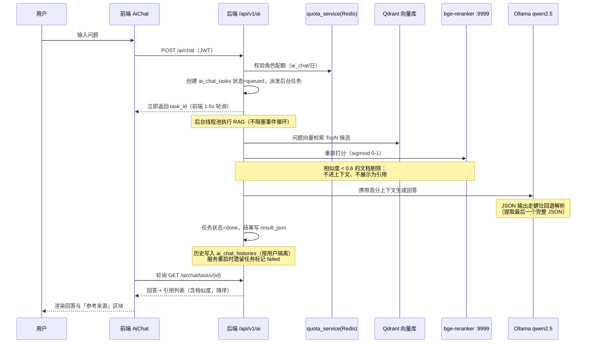
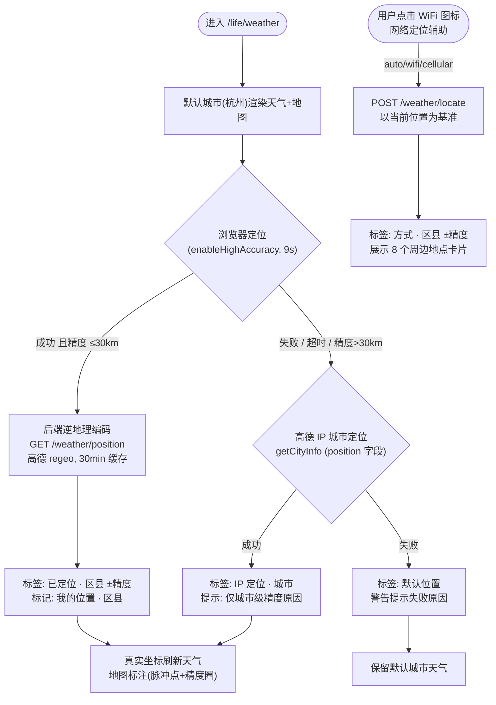
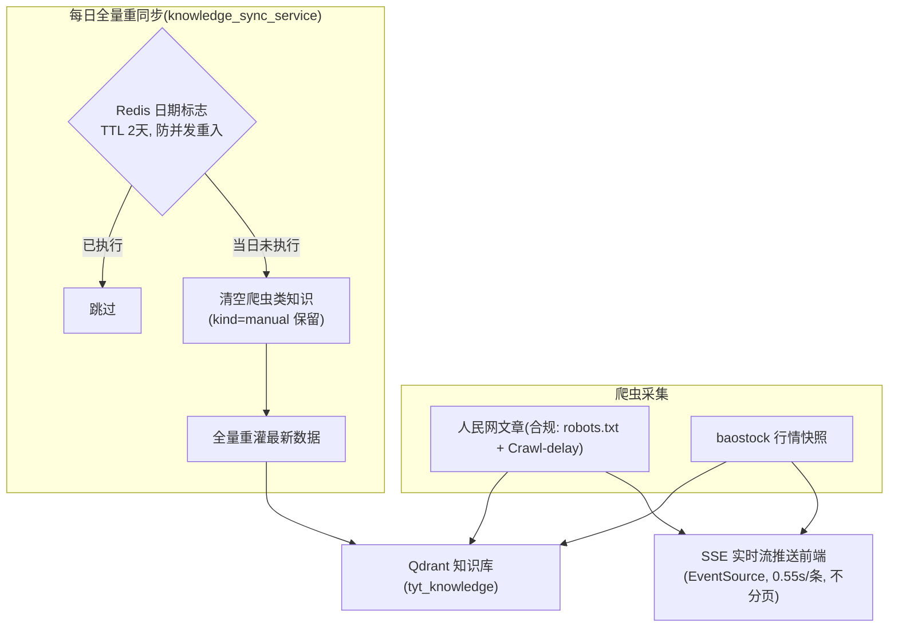
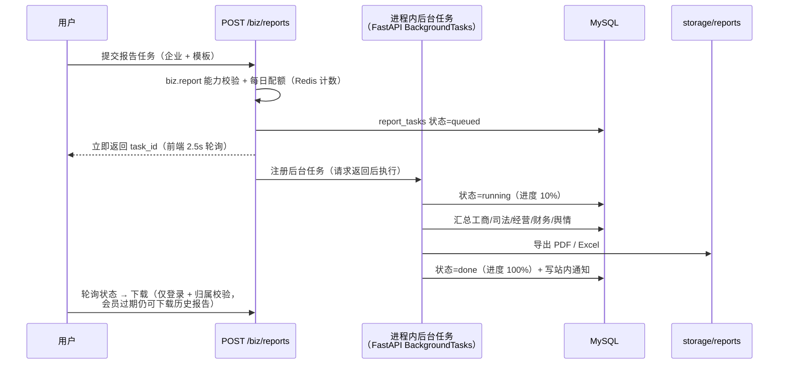
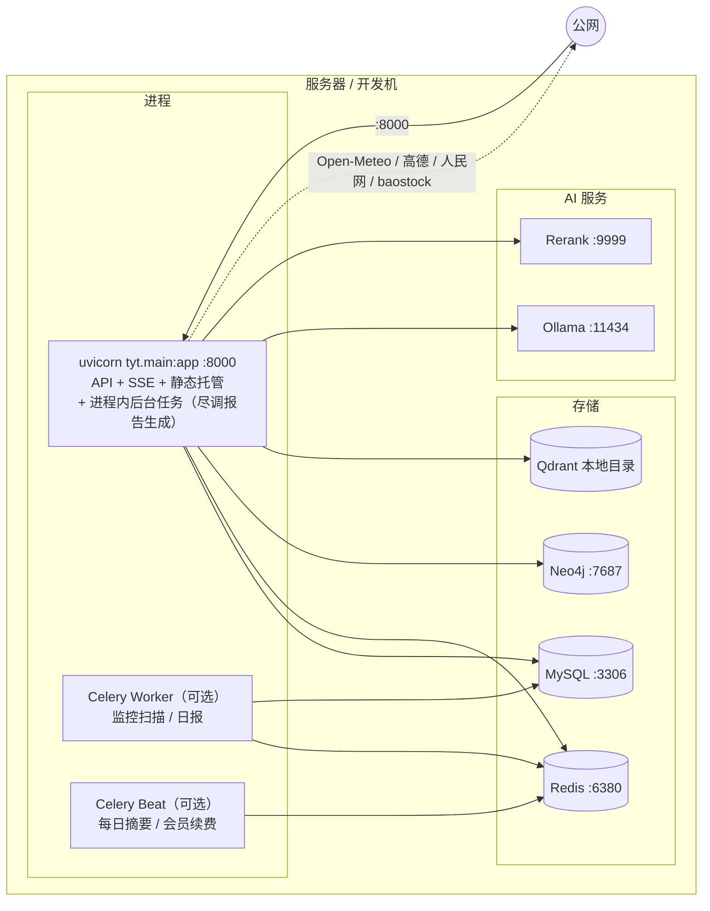

# 天眼通（SkyEye）v2.9.2 项目需求书

| 项目 | 内容 |
|---|---|
| 项目名称 | 天眼通 SkyEye v2.9.2（后端包名 `tyt`，前端 `tyt-web`） |
| 文档版本 | v2.9.2 |
| 编制日期 | 2026-10 |
| 系统形态 | 前后端分离 Web 平台（SPA + REST API） |

**修订记录**

| 版本 | 日期 | 说明 |
|---|---|---|
| v2.0 | 2026-10 | 初始基线版本 |
| v2.4 | 2026-10-11 | 新增高级会员订阅功能（§3.9）：头像弹层"升级权益"入口、包月/连续包月两方案（首月优惠）、模拟支付、到期自动续费/降级；会员权益界面按设计稿改为模态弹窗（MembershipDialog：周期切换/权益卡片/锁定态二维码扫码支付）；新增右上角消息中心（§3.10）：站内通知统一入口 + 帖子点赞/评论过审提醒 |
| v2.5 | 2026-10-11 | 尽调报告深度版落地（BIZ-05）：深度版模板差异化实现（追加工商变更记录、分支机构、完整风险明细、AI 综合研判段落，PDF/Excel 同步）；报告创建接口补执行每日配额校验（此前配额矩阵已定义但未执行，超限返回 429） |
| v2.8 | 2026-10-11 | 联调测试修复批次：① 会员角色实时生效——后端能力校验改为按 DB 实时角色（Redis 15s 缓存 + 变更即失效），后台改角色/自助升级/到期自动降级均无需重新登录即时生效；前端角色 30s 周期同步（落实 §2.3 三处一致）；② 尽调报告生成改为 API 进程内后台任务异步生成，不再依赖独立 Celery worker，任务状态正常推进（修复"一直排队中"）；③ 会话保持——应用启动时主动用 refresh token 续期后再拉取用户信息，重开网站免重新登录；logout 同步吊销 refresh token；④ 会员过期历史保留——会员过期后仍可查看/下载历史生成的尽调报告、查看监控关注列表/风险事件/站内通知/订阅设置（查看类接口改为仅登录 + 用户隔离校验），生成新报告、新增/取消监控等实时操作仍需高级会员（明确 §3.9 权益边界：实时能力随会员失效，用户自有历史记录保留）；⑤ 架构图同步重绘（§4.1 总体架构、§6.4 报告生成时序、§8.1 部署架构）与 §7 异步描述，对齐 v2.8 实际实现 |
| v2.9 | 2026-10-12 | 向量库由 Chroma 迁移为 **Qdrant**（本地持久化模式 `QdrantClient(path=...)`，无需独立服务进程，等价于原 Chroma PersistentClient）；同步修复两处缺陷：① RBAC 角色实时缓存读取误用 `cached.decode()`（Redis 已配置 `decode_responses=True` 返回 str，导致角色缓存形同虚设、每次请求回源 DB）改为直接返回；② 企业搜索 MySQL FULLTEXT(ngram) 分支误用 `func.match(...).against(...)`（SQLAlchemy 2.x 无此 API，构造期抛 AttributeError，FULLTEXT 检索从未生效、永久降级 LIKE），改为 `text("MATCH(...) AGAINST (:kw)")` + bindparam 真正启用全文检索；项目后端依赖与运行环境统一到 conda base（Python 3.13） |
| v2.9.1 | 2026-10-13 | ① AI 问答升级**多路召回**：向量语义召回（bge+Qdrant Top8）+ jieba 关键词召回（语料 60s 缓存）双路并行，RRF（k=60）融合去重 → bge-reranker 精排 → 阈值过滤；② 修复识图两处缺陷：识别图片 base64 溢出 TEXT 上限（改 MEDIUMTEXT）、MiniCPM-V 偶发输出残缺 JSON 导致"无输出"（`format:"json"` 强制 + 残缺修复 + 解析失败重试 + tags/confidence 容错）；③ 平台管理新增**模型管理**：百炼问答开关（qwen-plus，DashScope OpenAI 兼容）与百炼识图开关（qwen-vl-ocr，独立 Key）双开关联动双模型讲解卡片，按角色路由（高级会员及以上走百炼，普通用户始终本地），百炼失败/不可解析自动降级本地 qwen2.5:1.5b / minicpm-v4.6；④ 预热范围约定：仅本地模型（chat/embed/vision）常驻预热，百炼云端按需调用不预热；⑤ AI 问答页 / AI 识图页模型名称跟随管理端开关与用户角色动态显示 |
| v2.9.2 | 2026-10-13 | ① 知识库**文档导入**：管理端知识库新增「导入文档」能力，支持 txt / md / csv / docx / pdf / xlsx / html 拖拽或点击上传，服务端按扩展名自动识别文本（利用已装 pypdf / python-docx / openpyxl / bs4，零新增依赖），按段落/句子语义切分并自动识别标题，逐片段以 `kind=manual` 入库（`kind=manual` 不参与每日爬虫清理、长期保留）；② 知识库清理策略明确化：每日一清仅删除爬虫来源（`people_article` 人民网资讯 / `baostock_quote` 行情快照），手动录入（`manual`）与企业卡片（`company_card`）永久保留，删除前二次校验 `kind` 白名单防误删；③ 新增《天眼通会员退款准则》配套文档（退款条件 / 时效 / 不可退情形 / 流程），详见 §3.9 退款准则 |

---

## 1. 项目概述

### 1.1 项目背景与定位

天眼通是一个面向个人与中小企业的**生活服务 + 商业尽调一体化数据查询平台**，融合公开工商数据、生活服务信息、社区UGC、本地AI能力，为用户提供：

- **生活侧**：商家/房源/求职公司/个人背景查询、定位天气、AI 识图、生活圈社区；
- **商业侧**：企业工商信息查询、关系图谱、风险扫描、商业监控、尽调报告、商机线索、多智能体股票分析；
- **AI 侧**：基于本地大模型的 RAG 问答（可溯源引用）、图像识别、智能体协作分析；
- **平台侧**：RBAC 权限管控、每日配额、内容审核、数据来源合规治理。

所有模型推理均通过 **Ollama 本地化部署**，业务数据以公开渠道合规获取（见 §3.7）。

### 1.2 项目目标

1. 提供一站式"生活避坑 + 商业风控"查询服务，普通用户到平台管理员均可在权限范围内自助使用；
2. 通过角色配额体系实现免费/付费分级运营能力；
3. 通过本地 AI（对话/嵌入/视觉/重排）实现零外部 API 依赖的智能问答与识图；
4. 建立数据来源登记与审计机制，保证数据合规可溯源；
5. 保证核心链路（查询、问答、社区）在演示/生产环境均可稳定运行。

### 1.3 术语

| 术语 | 说明 |
|---|---|
| RBAC | 基于角色的访问控制（路由级 + 菜单级 + 接口能力级三处一致校验） |
| RAG | 检索增强生成：向量检索 + 重排 + 大模型生成，回答附引用来源 |
| 尽调报告 | 对目标企业的多维度（工商/司法/经营/财务/舆情）自动汇总报告 |
| 先审后发 | UGC 内容命中违规词直接拒审，其余进入待审队列 |
| 配额 | 按角色每日限次（-1 为不限），Redis 计数、自然日重置 |

---

## 2. 用户角色与权限体系

### 2.1 角色定义

| 角色 | 代码 | 定位 |
|---|---|---|
| 游客 | `guest` | 未登录，仅可体验少量生活/工商查询，禁止个人查询与全部 AI 能力 |
| 普通用户 | `user` | 注册用户，生活查询不限次，基础 AI 能力可用 |
| 高级会员 | `premium` | 付费用户，站内订阅开通（包月/连续包月，见 §3.9），解锁不限次风险/图谱/监控、报告与股票分析额度提升 |
| 企业管理员 | `enterprise_admin` | 企业账户，侧重图谱、报告、监控、线索 |
| 平台管理员 | `platform_admin` | 平台运营，全部能力 + 管理后台 |

### 2.2 每日配额矩阵

| 配额项 | guest | user | premium | enterprise_admin | platform_admin |
|---|:--:|:--:|:--:|:--:|:--:|
| 生活类查询（商家/房源/求职） | 3 | ∞ | ∞ | ∞ | ∞ |
| 个人查询 | 0 | 3 | 10 | 3 | ∞ |
| 工商基础查询 | 3 | ∞ | ∞ | ∞ | ∞ |
| 风险查询 | 0 | 10 | ∞ | ∞ | ∞ |
| 关系图谱查询 | 0 | 5 | ∞ | 20 | ∞ |
| 尽调报告 | 0 | 0 | 10 | 30 | ∞ |
| 商业监控 | 0 | 0 | ∞ | ∞ | ∞ |
| 社区发帖 | 0 | 10 | ∞ | 10 | ∞ |
| AI 问答 | 0 | 20 | ∞ | 50 | ∞ |
| AI 识图 | 0 | 5 | ∞ | ∞ | ∞ |
| 股票分析 | 0 | 3 | 10 | 20 | ∞ |

### 2.3 权限一致性约束（强制）

功能访问权限调整时，**三处必须同步修改**，缺一不可：

1. 后端角色权限/能力校验（`require_capability`）；
2. 前端路由守卫 `meta.roles`；
3. 侧边栏菜单可见性。

---

## 3. 功能需求

### 3.1 认证与账户

| 编号 | 需求 | 说明 |
|---|---|---|
| AUTH-01 | 注册/登录 | 邮箱+密码注册；登录需勾选《用户协议》；JWT 鉴权（Access 24h / Refresh 7d） |
| AUTH-02 | 个人信息 | `/me` 返回账号、角色、配额用量、头像；昵称展示 |
| AUTH-03 | 头像修改 | **所有登录用户**可上传头像（jpg/png/webp/gif，≤2MB），保存至 `uploads/avatars/`，替换时自动清理旧文件；个人中心/侧边栏/顶栏三处同步显示 |
| AUTH-04 | 密码修改 | 校验旧密码，bcrypt 存储 |
| AUTH-05 | 审计日志 | 敏感操作（登录、头像更新等）写入 `audit_logs` |
| AUTH-06 | 敏感字段加密 | 个人查询等敏感字段 AES-GCM 加密存储 |

### 3.2 生活服务模块（`/life/*`）

| 编号 | 页面 | 需求 |
|---|---|---|
| LIFE-01 | 仪表盘 | 汇总展示核心指标、爬虫实时流入口 |
| LIFE-02 | 商家查询 | 商家检索 + 详情 + 用户评价（评分/评论，先审后发） |
| LIFE-03 | 房源查询 | 小区/房源信息检索；投诉登记（物业/中介/房东） |
| LIFE-04 | 求职避坑 | 求职公司背景查询，关联工商与风险数据 |
| LIFE-05 | 个人查询 | 按姓名等条件查询个人公开背景（脱敏+加密，配额限次，游客禁用） |
| LIFE-06 | AI 识图 | 上传图片（MiniCPM-V 视觉模型）识别场景/物体，支持追问；历史记录按用户隔离 |
| LIFE-07 | 定位天气 | 见 §6.2 专项流程 |

**定位天气详细需求**：

1. 数据源 Open-Meteo（免 Key），30 分钟缓存；地图渲染使用高德 JS API；
2. 定位链路（顺序降级）：浏览器定位（enableHighAccuracy，9s 超时）→ 高德 IP 城市定位兜底（无需授权）→ 默认城市（杭州）；
3. 浏览器定位精度 >30km（纯 IP 猜测）视为不可用，自动改走 IP 定位；
4. 定位成功后经后端**逆地理编码**（`GET /weather/position`，高德 regeo，30 分钟缓存）解析城市+区县，标签显示「已定位 · 区县 ±精度」；
5. **网络定位辅助**（`POST /weather/locate`，第一版同款）：手动选择 自动融合（±50m）/ WiFi（±500m）/ 基站（±2km）三种方式，以当前已知位置为基准，返回城市+区县+精度+**8 个周边地点**（名称/类型/图标/距离，按距离排序）；
6. 定位失败必须显式提示原因（权限被拒/超时/不可用），不得静默回落；
7. 天气内容：当前天气、逐时预报、7 日趋势、生活指数、空气质量、地图图层切换、全屏地图、用户位置标注（脉冲光点+精度圈）。

### 3.3 生活圈社区（`/community/*`）

| 编号 | 需求 |
|---|---|
| COMM-01 | 帖子列表/详情：分页浏览、正文/图片、点赞 |
| COMM-02 | 发帖/评论：登录用户按配额发帖；内容先审后发 |
| COMM-03 | 内容审核：违规词库存 MySQL，管理端动态编辑（预设分组勾选+自定义词+去重）立即生效；命中词在待审内容中标红展示 |
| COMM-04 | 举报：用户可举报帖子/评论（虚假信息/侵犯隐私/造谣诽谤/辱骂攻击/广告/其他） |
| COMM-05 | 商家评价与小区投诉同走审核流 |

### 3.4 商业尽调模块（`/biz/*`）

| 编号 | 页面 | 需求 |
|---|---|---|
| BIZ-01 | 企业查询 | 工商信息检索（MySQL/ES 双引擎，ES 未启用自动降级 MySQL FULLTEXT ngram） |
| BIZ-02 | 企业详情 | 工商照面 + Tab 页：股东、主要人员、对外投资、变更记录、分支机构、风险记录 |
| BIZ-03 | 关系图谱 | Neo4j 图数据库 + AntV G6 前端渲染，企业/人员股权与任职关系探索 |
| BIZ-04 | 商业监控 | 关注企业（watch_items）+ 定时扫描（Celery 每小时）产生事件（watch_events）+ 站内通知 + 日报/周报摘要 |
| BIZ-05 | 尽调报告 | 多维数据自动汇总生成报告，Celery 异步任务（generate_report_task），支持导出（storage/reports）；标准版/深度版双模板：深度版追加工商变更记录、分支机构、完整风险明细（标准版明细截断 8 条）与本地大模型 AI 综合研判段落（风险态势/重点关注/尽调建议，生成失败不阻断）；创建接口执行每日配额（Redis 计数，premium 10 篇/日） |
| BIZ-06 | 商机线索 | 线索发现、跟进记录（lead_follows）、收藏（lead_favorites） |
| BIZ-07 | 股票分析 | 多智能体协作（baostock 行情数据）分析指定股票/指数 |

### 3.5 AI 能力

| 编号 | 需求 |
|---|---|
| AI-01 | AI 问答（`/ai`）：RAG 流程见 §6.1；对话历史按用户隔离存储（ai_chat_histories），严格属主校验 |
| AI-02 | 引用溯源：参考来源按相似度降序展示，每条含相似度数值，**相似度阈值 0.6**——低于阈值的文档不得进入生成上下文也不得展示 |
| AI-03 | AI 识图：Ollama MiniCPM-V，调用时必须禁用思考模式（`think: false`），返回 record_id 供追问链路 |
| AI-04 | 模型预热：服务启动后台顺序加载对话/嵌入/视觉模型至内存，周期刷新防卸载；预热失败仅告警不阻断启动，下周期自动重试 |
| AI-05 | 输出解析：对大模型 JSON 输出实现健壮回退解析（扫描配对花括号提取最后一个完整 JSON 对象） |
| AI-06 | **问答异步任务化**：POST `/ai/chat` 提交后立即返回 task_id（RAG 全链路后台线程池执行，不阻塞事件循环），前端 1.5s 轮询 GET `/ai/chat/tasks/{id}` 获取回答；任务状态 queued→running→done/failed（ai_chat_tasks 表跟踪）；**用户离开页面回答不丢**（轮询停止但后台继续执行，完成后自动入历史，回到页面即可见）；服务重启时遗留 queued/running 任务自动标记 failed（前端轮询可感知并提示重新提问） |
| AI-07 | 回答 Markdown 渲染：助手回答以 Markdown 格式输出并渲染（marked+DOMPurify 消毒，支持加粗/列表/小标题/代码块/表格），后端提示词引导结构化输出并限制篇幅（≤300字、2-4 小节），Ollama 调用启用 repeat_penalty 抑制小模型复读 |

### 3.6 平台管理后台（`/admin`，仅 platform_admin）

| 编号 | 需求 |
|---|---|
| ADM-01 | 用户与角色管理 |
| ADM-02 | 内容审核（待审帖/评论/评价/举报，内容类型标签必须区分明确） |
| ADM-03 | 违规标准编辑（参考第一版：预设分组勾选/单词勾选/手动添加/自动去重/保存全量替换立即生效；空提交 400 拒绝；兼容旧纯字符串格式） |
| ADM-04 | 知识库管理：服务端分页（10 条/页），支持类型筛选+关键词搜索；**文档导入**（ADM-06）：拖拽/选择上传常见格式文档，服务端自动提取文本、语义切分、自动标题识别后逐片段以 `kind=manual` 入库；**每日清理策略**：每日一清仅删除爬虫来源（`people_article` / `baostock_quote`），手工知识（`kind=manual`）与企业卡片（`company_card`）永久保留，删除前二次校验 `kind` 白名单防误删 |
| ADM-05 | 数据源登记与采集日志（合规溯源） |

### 3.7 数据治理与合规

1. **数据来源登记**（data_sources）：国家企业信用信息公示系统、信用中国、裁判文书网、执行信息公开网（人工导入）；人民网舆情（合规爬虫，遵守 robots.txt 与 Crawl-delay）；baostock 证券数据（官方 SDK）；演示种子数据；第三方商业 API（未授权不启用）；
2. 演示数据必须标注「演示数据（整理自公开工商信息，仅供功能验证）」；
3. 敏感个人信息脱敏 + AES-GCM 加密；
4. 全操作审计日志。

### 3.8 爬虫与实时流

| 编号 | 需求 |
|---|---|
| CRW-01 | 人民网文章爬取（舆情知识源）与 baostock 行情快照采集 |
| CRW-02 | 实时流：SSE 推送（前端必须使用原生 EventSource，避免 fetch 中断报错） |
| CRW-03 | 实时流窗口不受 10 条/页分页限制，展示全部新抓取信息；推送间隔与前端滑入动画对齐（约 0.55–0.57s/条） |
| CRW-04 | 每日爬虫知识**全量清理重同步**（防过期数据污染 RAG），以 Redis 日期标志防并发重入，标志 TTL 2 天跨重启持久 |
| CRW-05 | 数据源切换使用「序号失效 + 静默读旧流」策略，避免控制台红色报错 |

### 3.9 会员订阅（弹窗式，高级会员购买）

平台**仅设一种会员类型（高级会员）**，普通用户可站内付费升级；演示环境使用**模拟支付**（不接入真实支付渠道）。会员权益以**模态弹窗**（`MembershipDialog` 组件）形式呈现，不再使用独立页面。

| 编号 | 需求 | 说明 |
|---|---|---|
| BILL-01 | 升级入口 | 顶栏**点击头像弹出用户菜单**：普通用户显示深色"升级权益"入口块（皇冠图标）→ **打开会员权益弹窗**；高级会员显示"会员中心"入口，打开同一弹窗（标题切换为"会员中心"） |
| BILL-02 | 弹窗布局 | 头部标题+副标题；用户信息条（头像/昵称/角色标签；**连续包月自动续费中不显示会员到期日**，仅显示"自动续费中·服务持续有效"，取消自动续费后才显示"会员有效期至 xx"）；计费周期切换（**连续包月**默认选中"省钱推荐" / **单月购买**）；深色高级会员卡片（首月优惠角标、划线原价、9 项权益清单 ✓）；底部支付区（支付宝/微信渠道 + **锁定态二维码**（未同意协议时显示锁遮罩"同意协议后扫码支付"）+ 应付金额 + 价格说明含下次续费时间 + 协议勾选） |
| BILL-03 | 订阅方案 | 连续包月 ¥29/期（首月 ¥19）、包月 ¥35/期（首月 ¥25）；每期 30 天；首购资格按"是否存在已支付订单"判定，非首购一律原价；权益介绍按项目实际配额矩阵展示（9 项），每项附普通用户对比 |
| BILL-04 | 支付流程 | 弹窗内选择周期 → 勾选订阅条款（锁遮罩消失、支付按钮解锁）→ "立即升级·扫码支付"生成订单（二维码按订单号确定性绘制）→ "模拟支付成功"确认后订单置 paid；角色即时升级为 premium（顶栏标签同步变色）、有效期 = max(当前, 原有效期) + 30 天；切换周期使待支付订单失效（可"取消支付"） |
| BILL-05 | 自动续费与到期 | **开通/支付成功即时升级 premium**；连续包月：Celery 每日任务扫描已到期且开启自动续费的会员，模拟扣款续期并生成订单+站内通知；用户可在弹窗内随时取消自动续费；**到期且未续费（包月/已取消自动续费）：每日 Celery 任务自动降级为 user**（清空到期日+站内通知，不依赖用户下次登录；登录时再校验一次作为兜底） |
| BILL-06 | 订单与状态 | 弹窗展示当前状态（角色/有效期/自动续费）与"订阅记录"折叠区（订单列表）；企业管理员/平台管理员访问显示"无需购买"提示；下单/支付/取消续费写审计日志 |
| BILL-07 | 退款准则 | 制定《天眼通会员退款准则》配套文档：明确可退款情形（重复扣费 / 服务未开通 / 重大故障）、退款时效（连续包月首期冷静期内可申请、已消费权益按比例折算）、不可退情形（虚拟权益已使用 / 活动特价 / 违反用户协议）；退款由用户发起 → 平台审核 → 原路退回 |

> **退款准则**：平台已制定《天眼通会员退款准则》配套文档，详述退款条件、时效、不可退情形与流程；会员弹窗"订阅记录"区提供退款申请入口，发起后由平台管理员在管理后台审核处理。

### 3.10 消息中心（右上角铃铛）

顶栏右上角提供统一**站内消息中心**入口，汇总各业务模块对当前用户的提醒；所有登录用户可用（无角色限制，通知严格按用户隔离）。通用接口 `GET/POST/DELETE /api/v1/notifications`（原有 `/biz/monitor/notifications` 保留供监控页使用，底层同走 notification_service）。

| 编号 | 需求 | 说明 |
|---|---|---|
| NOTIF-01 | 入口与徽标 | 顶栏铃铛图标 + 未读数徽标（为 0 隐藏、上限 99）；铃铛弹层与用户菜单弹层互斥 |
| NOTIF-02 | 通知来源 | 四类：monitor 商业监控事件、membership 会员续费/到期、audit 审核结果、**social 社区互动**——帖子被他人**点赞**即时通知；帖子收到**评论且管理员审核通过后**通知（评论先审后发，避免审核拒绝后的误导通知）；自己点赞/评论自己的帖子不提醒；通知带 ref_url（`/community/{id}`），点击跳转帖子详情 |
| NOTIF-03 | 已读管理 | 单条点击即置已读并跳转来源页；**已读消息再次点击则从列表移除（消失）**，重开面板不回归；面板内"全部已读"一键清零；未读项高亮显示（未读点 + 底色） |
| NOTIF-04 | 刷新机制 | 30 秒轮询未读数 + 路由切换时同步刷新；面板打开时拉取最近 10 条通知 |

---

## 4. 系统架构

### 4.1 总体架构图



### 4.2 技术选型

| 层 | 技术 | 版本 | 用途 |
|---|---|---|---|
| 前端框架 | Vue 3 + TypeScript | 3.4 / 5.4 | 组合式 API SPA |
| UI 组件 | Element Plus | 2.7.5 | 中后台组件库（中文 locale） |
| 状态管理 | Pinia | 2.1 | auth 等全局 store |
| 路由 | Vue Router | 4.3 | history 模式 + 路由守卫 |
| 可视化 | ECharts / AntV G6 | 5.5 / 4.8 | 图表 / 关系图谱 |
| HTTP | Axios | 1.7 | 拦截器统一鉴权与错误提示 |
| 构建 | Vite | 5.2 | 生产构建（vue-tsc 类型检查） |
| 后端框架 | FastAPI + Uvicorn | — | REST API + SSE + 静态托管 |
| ORM | SQLAlchemy 2 | — | 声明式模型 + Session |
| 数据校验 | Pydantic v2 | — | 请求模型 + field_validator |
| 任务队列 | Celery + Beat | — | 异步/定时任务 |
| 数据库 | MySQL 8.0 | — | 业务主库（utf8mb4） |
| 缓存 | Redis 7 | — | 缓存/配额/标志/Broker |
| 图数据库 | Neo4j 5 | — | 股权任职图谱 |
| 向量库 | Qdrant | — | RAG 知识库 |
| 本地推理 | Ollama | — | 对话/嵌入/视觉三模型 |
| 重排 | bge-reranker-v2-m3 | — | HTTP 服务 :9999 |

### 4.3 前端页面清单

```
web/src/views/
├── LandingView.vue          落地页（滚动 reveal 动画，风格对齐第一版）
├── LoginView.vue / RegisterView.vue / NotFoundView.vue
├── life/    LifeHome(仪表盘) MerchantSearch HousingSearch JobCompany
│            PersonSearch AiVision WeatherMap
├── community/  CommunityHome PostDetail
├── biz/     BizHome CompanySearch CompanyDetail GraphExplorer
│            MonitorCenter ReportCenter LeadCenter StockAgents
├── ai/      AiChat
├── admin/   AdminConsole
└── me/      ProfileView（账号信息/头像/配额/密码）

web/src/components/
└── MembershipDialog.vue    会员权益弹窗（周期切换/方案卡片/扫码支付/订阅记录）
```

### 4.4 后端服务层（tyt/services，22 个）

| 服务 | 职责 |
|---|---|
| auth_service | 登录/注册/用户信息/头像字段 |
| quota_service | 每日配额计数（Redis，自然日重置） |
| audit_service | 审计日志落库 |
| company_service / risk_service / graph_service | 工商检索 / 风险聚合 / Neo4j 图谱查询 |
| monitor_service / report_service / lead_service | 监控扫描 / 报告生成 / 线索管理 |
| stock_service | 多智能体股票分析 |
| ai_service | RAG 问答（检索+重排+生成+引用） |
| vision_service | MiniCPM-V 识图 |
| community_service / violation_service | 社区业务 / 违规词库检测 |
| weather_service | 天气缓存 / 逆地理编码 / 网络定位辅助 |
| crawler_stream_service | 爬虫采集与 SSE 实时流 |
| knowledge_sync_service | 每日知识全量清理重同步（Redis 日期标志） |
| model_warmup | 模型常驻内存预热与周期刷新 |
| import_service | 管理端数据导入 |
| billing_service | 会员订阅（方案/下单/支付/自动续费/订单） |
| notification_service | 站内通知（列表/未读数/已读标记，按用户隔离） |

---

## 5. 数据架构

### 5.1 存储分工

| 存储 | 职责 |
|---|---|
| MySQL | 全部业务表（用户/企业/社区/监控/线索/治理） |
| Redis | 天气与定位缓存、配额计数、每日同步日期标志、Celery Broker |
| Neo4j | 企业-人员股权/任职关系图 |
| Qdrant | 知识库向量（tyt_knowledge 集合，真实路径 `database/tyt_qdrant-client`） |
| 本地文件 | 头像 `uploads/avatars/`、社区图片、报告导出 `storage/reports/` |

### 5.2 核心数据模型（30+ 表）

```mermaid
erDiagram
    users ||--o{ audit_logs : "操作"
    users ||--o{ ai_chat_histories : "对话(按用户隔离)"
    users ||--o{ posts : "发帖"
    users ||--o{ watch_items : "关注企业"
    users ||--o{ leads : "线索"
    users ||--o{ membership_orders : "会员订阅"

    companies ||--o{ company_personnel : "主要人员"
    companies ||--o{ company_shareholders : "股东"
    companies ||--o{ company_investments : "对外投资"
    companies ||--o{ company_branches : "分支机构"
    companies ||--o{ company_changes : "变更记录"
    companies ||--o{ risk_records : "风险(司法/经营/财务/舆情/行政处罚)"
    companies ||--o{ watch_items : "被监控"
    companies ||--o{ report_tasks : "尽调报告"

    posts ||--o{ post_comments : "评论"
    posts ||--o{ post_likes : "点赞"
    posts ||--o{ report_records : "被举报"

    merchants ||--o{ merchant_reviews : "商家评价"
    housing_estates ||--o{ complaints : "投诉(物业/中介/房东)"
    watch_items ||--o{ watch_events : "监控事件"
    watch_items ||--o{ monitor_schedules : "扫描计划"
    leads ||--o{ lead_follows : "跟进"
    leads ||--o{ lead_favorites : "收藏"
```



---

## 6. 关键业务流程

### 6.1 AI RAG 问答流程（异步任务模式）



### 6.2 定位天气定位链路



### 6.3 爬虫知识与每日同步



### 6.4 尽调报告异步生成（v2.8：API 进程内后台任务，不依赖 Celery worker）



> 注：报告生成不经过 Celery 队列，即使部署未启动 Celery Worker 也始终可用；
> 监控扫描/日报/会员续费仍为 Celery 周期任务，需单独启动 Worker + Beat（见 §8.1）。

---

## 7. 非功能需求

| 类别 | 需求 |
|---|---|
| 性能 | 模型启动即预热常驻内存，首次请求热态响应；天气/定位/逆地理编码 30 分钟缓存；列表页服务端分页（10 条/页） |
| 异步 | **全平台查询/问答/文档生成均异步化**：耗时型功能走后台任务/流式——尽调报告 API 进程内后台任务异步生成（task_id+进度轮询，不依赖独立 Celery worker）、AI 问答后台任务+轮询（AI-06）、AI 识图 async 推理 + SSE 追问、股票多智能体 SSE 流水线、知识库重同步后台执行、爬虫实时流 SSE；毫秒级常规查询（企业/生活/风险/监控）由 FastAPI 线程池并发处理不阻塞事件循环，前端全量 axios 异步加载 |
| 安全 | JWT 鉴权；RBAC 三处一致校验；bcrypt 密码；AES-GCM 敏感字段加密；UGC 先审后发；上传类型/大小白名单（头像 jpg/png/webp/gif ≤2MB） |
| 可靠性 | ES 未启用自动降级 MySQL 全文；模型预热失败不阻断启动；Rerank 不可用回退余弦相似度（注意 L2 空间下 1-distance 非有效相似度）；Open-Meteo 失败降级演示数据 |
| 兼容性 | 现代浏览器（Chrome/Edge）；SPA history 路由由后端 fallback 支持；HTML 响应带 `Cache-Control: no-cache` 防旧 index.html 白屏 |
| 可追溯 | 操作审计日志；数据来源登记；演示数据显式标注 |
| 体验 | 界面配色与第一版 frontend 风格一致；落地页滚动动画沿用第一版 reveal 体系；爬虫流推送节奏与滑入动画对齐 |

---

## 8. 外部依赖与部署

### 8.1 部署架构



> 注：尽调报告生成已内置 uvicorn 进程内（BackgroundTasks），Celery Worker + Beat 为可选进程——
> 不启动时报告生成/下载不受影响，仅监控周期扫描、日报/周报投递与会员到期自动续费/降级不执行
>（会员到期也可由登录/请求时的实时角色校验兜底感知）。

### 8.2 外部依赖清单

| 依赖 | 地址（默认） | 失败策略 |
|---|---|---|
| MySQL 8.0 | 127.0.0.1:3306 库 SkyEye2.0 | 启动强依赖 |
| Redis 7 | 127.0.0.1:6380 | 启动强依赖 |
| Neo4j 5 | bolt://127.0.0.1:7687 | 图谱功能强依赖 |
| Elasticsearch | 127.0.0.1:9200（默认关闭） | 降级 MySQL FULLTEXT |
| Ollama | 127.0.0.1:11434（qwen2.5:1.5b / bge-large-zh / MiniCPM-V） | AI 功能强依赖 |
| Rerank | 127.0.0.1:9999 | 回退 Qdrant 余弦相似度 |
| 高德地图 JS | Web Key（环境变量可覆盖） | 地图功能依赖 |
| Open-Meteo | 免 Key | 降级演示数据 |
| baostock | 官方 SDK | 行情功能依赖 |

### 8.3 环境变量（可覆盖项）

`TYT_MYSQL_*`、`TYT_REDIS_*`、`TYT_NEO4J_*`、`TYT_ES_ENABLED/ES_URL`、`TYT_OLLAMA_BASE_URL`（及三模型名）、`TYT_AMAP_KEY`、`TYT_RERANK_URL`、`TYT_JWT_SECRET`、`TYT_AES_KEY`（生产必须注入 32 字节密钥）。

---

## 9. 验收要点（关键功能清单）

| 模块 | 验收项 |
|---|---|
| 认证 | 注册/登录（须勾选协议）；任意角色可改头像且三处同步、≤2MB 校验、旧文件清理 |
| 生活 | 商家/房源/求职查询正常；个人查询游客 403、配额递减 |
| 定位天气 | 浏览器定位 → 显示到区县 ±精度；失败 → IP 定位兜底并显式提示；网络定位辅助三方式 + 周边地点 8 条；全失败回落默认城市 |
| 社区 | 发帖先审后发；命中违规词拒审且标红；举报入库 |
| 商业 | 企业详情 6 类 Tab 数据完整（注意 {items} 解包与字段名对齐）；图谱可展开；报告异步生成可下载；监控事件与日报按计划触发 |
| AI | 问答引用按相似度降序且 ≥0.6；历史按用户隔离；识图可追问；模型热态 |
| 管理后台 | 违规词库编辑立即生效；知识管理 10 条/页 + 筛选；**文档导入可拖拽上传并入库为 manual**；**每日清理仅清爬虫类（people_article / baostock_quote）、保留 manual / company_card** |
| 会员订阅 | "升级权益"入口仅普通用户可见且以弹窗打开（不跳转页面）；未勾选协议时二维码锁定、支付按钮禁用；支付后角色即时升级（顶栏标签变色）；**连续包月自动续费中不显示到期日，取消自动续费后才显示**；连续包月可取消自动续费、到期 Celery 自动续费；**到期未续费由 Celery 每日任务自动降级（不依赖登录）**；非首购按原价计费；订阅记录/审计完整 |
| 消息中心 | 顶栏铃铛未读徽标准确（0 隐藏、上限 99）；他人点赞帖子**即时**产生 social 提醒、评论**审核通过后**产生提醒（拒审不通知）；自己赞/评自己帖子不提醒；点击通知置已读并跳转 `/community/{id}`；**已读消息再次点击从列表消失（重开面板不回归）**；"全部已读"后徽标消失、未读高亮清除；通知严格按用户隔离（互相不可见） |
| 工程 | 前端 `vue-tsc --noEmit` 零错误；API 鉴权（401/403/422）边界正确；HTML no-cache 生效 |
